# ReZ POS: showcase

ReZ is a point-of-sale system for table-service restaurants. It runs in a web browser on tablets and a kitchen screen. It is built for small independent restaurants that want seat-by-seat ordering without buying expensive hardware.

**The source code is private.** This repo has screenshots and text only. For a demo, email rzk.karimi@gmail.com.

All screenshots show demo data: an invented Canadian pub menu, made-up dishes and prices, and made-up staff names. No real restaurant, guest or payment is shown. ReZ is a demo build: it does not take real card payments yet.

## Who it is for

Independent restaurants and pubs with a few tablets and one kitchen screen. The first market is Vancouver.

## What it does

- A floor plan you tap. Pub, cafe, banquet and grid layouts, with sections (bar, booths, dining, patio). Managers can drag tables to edit the floor.
- Seat-by-seat ordering. Share a dish between seats and the price divides to the cent.
- Merge tables for big parties and split them apart again.
- Dish changes: leave out ingredients, add extras, write a note. Allergy alerts appear as a red banner on the kitchen ticket. Allergens are set by the restaurant; the kitchen still confirms cross-contact risk.
- Hold and fire dishes. A kitchen screen with Fire, Ready and Bump buttons updates the tablets in about a second.
- Split checks by seat or evenly (2 to 9 ways). Payment sheet with cash, debit and credit, tips, automatic gratuity and 5-cent cash rounding.
- Staff sign-in with 4-digit codes, tablet pairing, manager and server roles checked by the server.
- A menu editor, tip-out rules, a time clock, shift reports and printable receipts.
- Works offline on a tablet and sends orders when the server is back.
- Planned tiers: a free tier for a small setup (up to 3 tablets and 1 kitchen screen) and a paid tier with everything included. Pricing on request; nothing is final.

## What it does not do yet

- No real card payments. Stripe is only wired in test mode.
- Not tested on real card readers or receipt printers.
- Not used in a live restaurant.
- An AI order assistant is not built.

## Screenshots

| | |
|---|---|
| 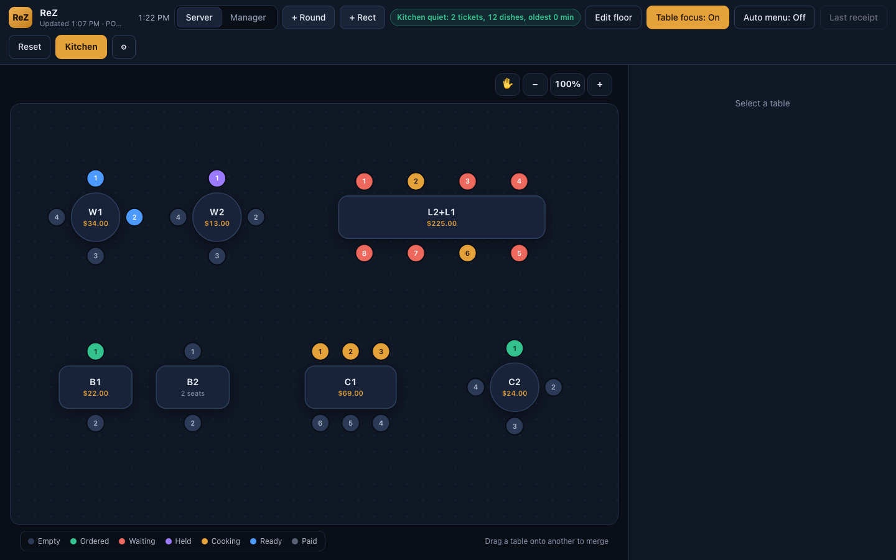 | 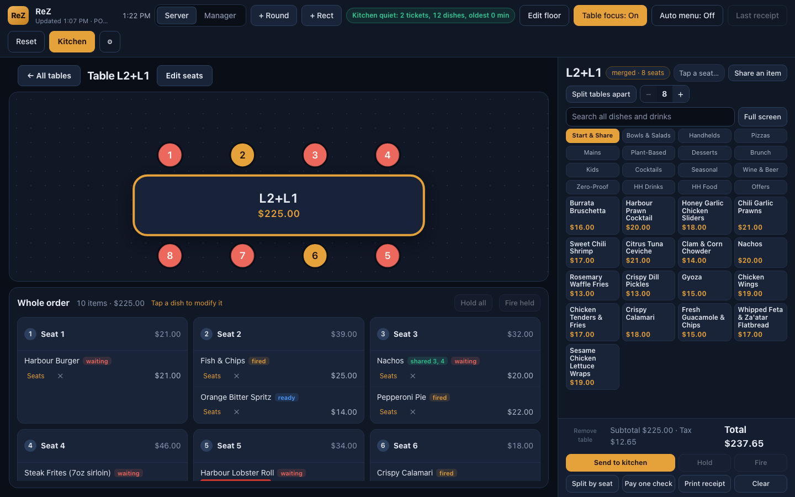 |
| Floor plan with table status colours | One table in focus with its whole order |
| 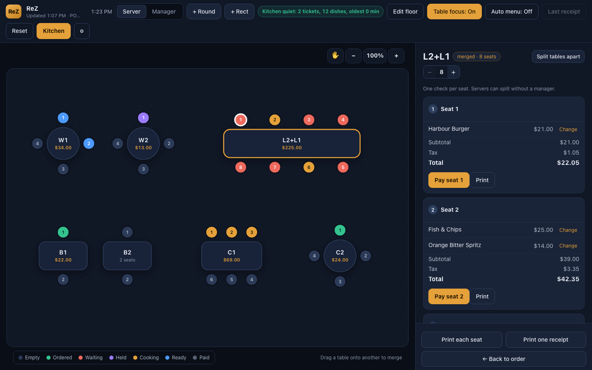 | 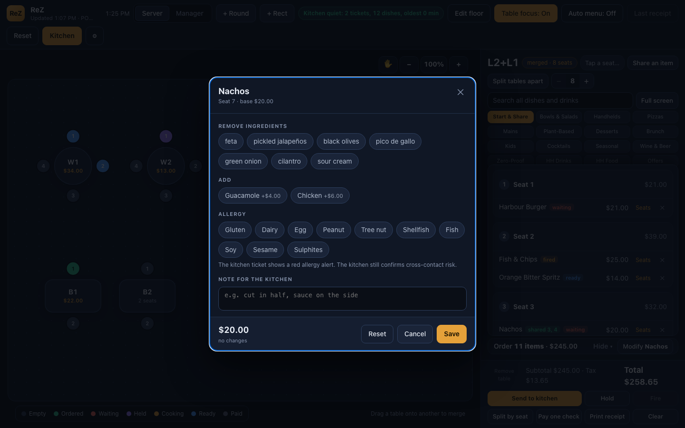 |
| One check per seat | Remove, add, allergy and kitchen note |
| 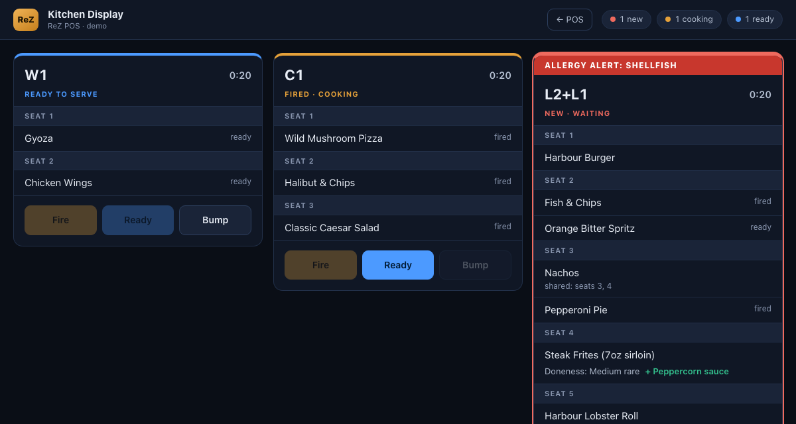 | 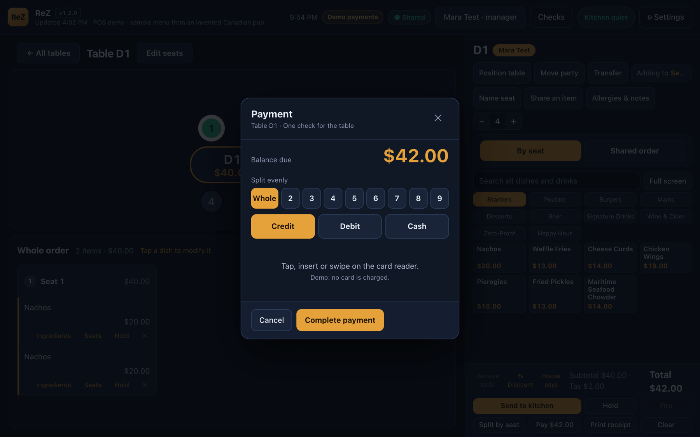 |
| Kitchen screen with an allergy alert | Payment sheet (demo, no card is charged) |
| 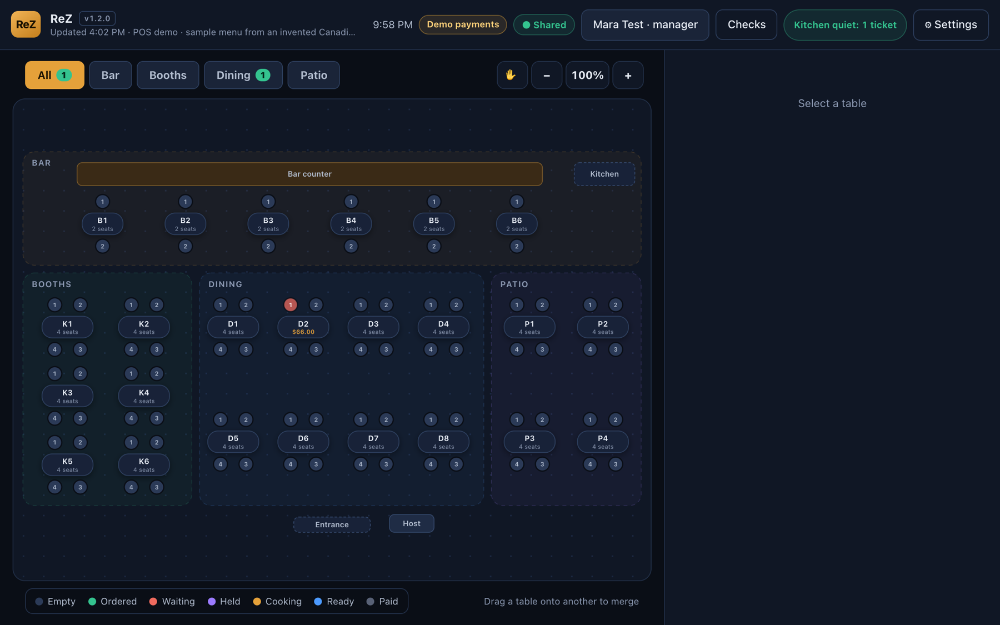 | 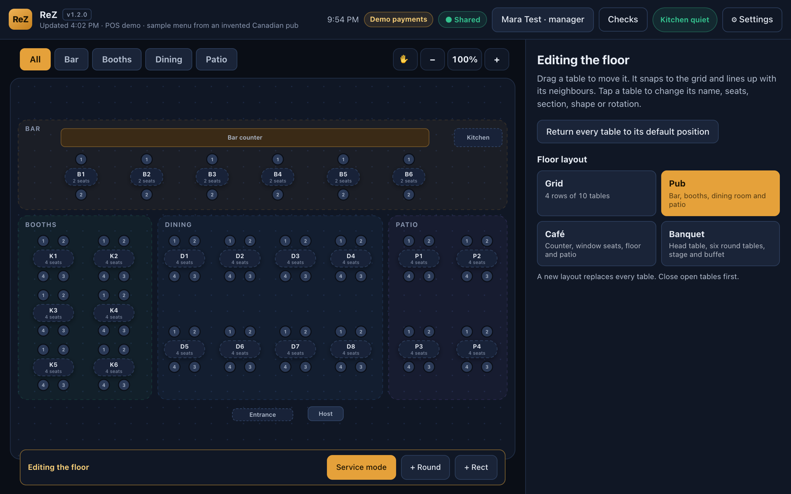 |
| Pub floor with sections | Choosing a floor layout in edit mode |
| 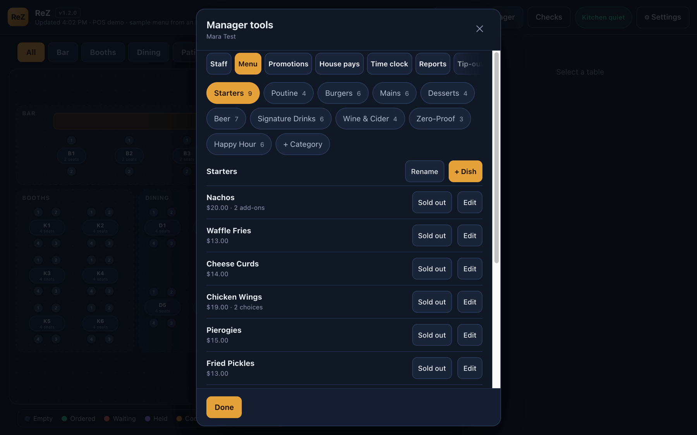 | 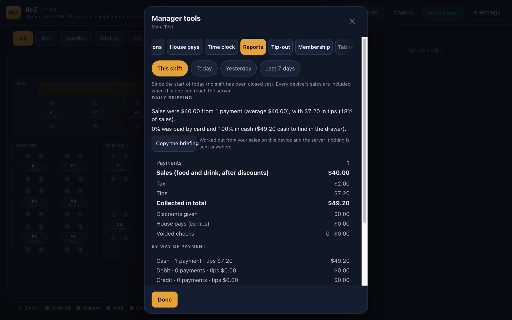 |
| Menu editor | Shift report with a daily briefing |

## Videos

Three short clips (20 to 30 seconds, no sound, captions on screen). They show the demo build with invented data. Select a link to play it on GitHub.

| | |
|---|---|
| [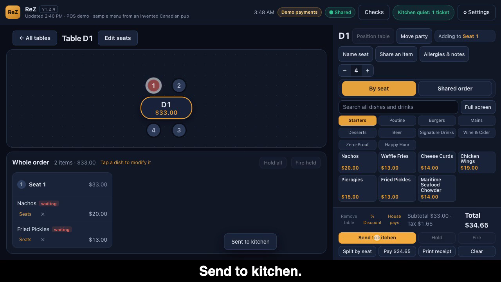](media/videos/clip-1-take-an-order.mp4) | [Take an order](media/videos/clip-1-take-an-order.mp4): tap a table, tap a seat, add dishes, send to the kitchen. |
| [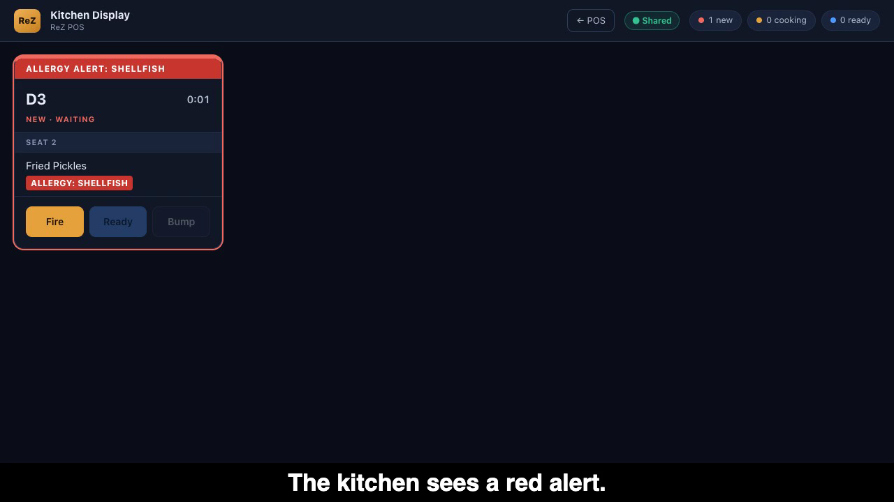](media/videos/clip-2-kitchen-allergy.mp4) | [Kitchen and allergy alert](media/videos/clip-2-kitchen-allergy.mp4): mark an allergy, see the red alert on the kitchen screen, Fire, Ready, Bump, and watch the tablet update. |
| [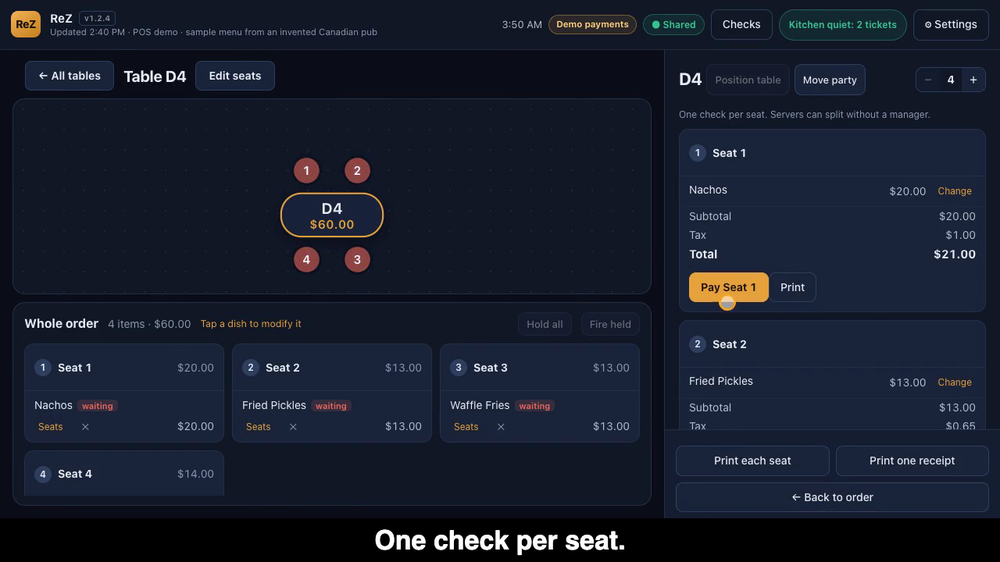](media/videos/clip-3-split-and-pay.mp4) | [Split the check and pay](media/videos/clip-3-split-and-pay.mp4): one check per seat, cash with change, then split evenly and pay guest by guest. Demo: no card is charged. |

How they were made: see [media/VIDEO-PLAN.md](media/VIDEO-PLAN.md).

## Contact

Razi Karimi, Vancouver. rzk.karimi@gmail.com

## Notices

ReZ is an independent project by Razi Karimi. It is not affiliated with or endorsed by Stripe or any other company named here; their names are trademarks of their owners and appear only to describe what ReZ works with. The screenshots show ReZ's own interface with invented sample data and contain no third-party images, logos or photos.

## Licence

Text and images here are all rights reserved. See [LICENSE](LICENSE). The ReZ source code is not part of this repo.
